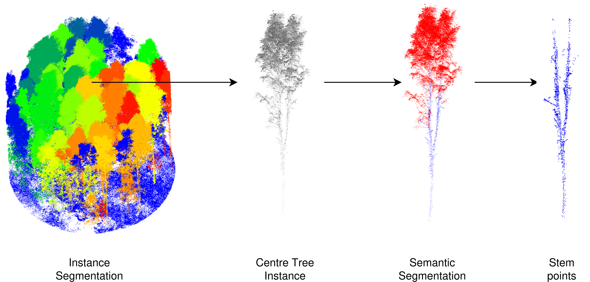

# Paper reproduction
Information needed to reproduce the numbers in the manuscript, from raw ALS
crops to the tables and figures. Divided into two parts:

- **Upstream pipeline**: the segmentation, centre-instance selection, stem
  extraction, and skeletonisation steps that take raw ALS crops to the
  AdTree skeleton PLYs consumed by `../scripts/fork_detect.py`. Uses external
  tools that must be installed separately.
- **Evaluation**: the fork-detection accuracy figures, the upstream pipeline error analysis,
  and the base-trunk RMSE against the MLS reference. Runs on the outputs of
  the upstream pipeline.

## Upstream pipeline

The manuscript reports two end-to-end pipelines that differ only in the
segmentation/classification models used. Both pipelines share the same
denoising, centre-instance selection, stem-extraction and skeletonisation
steps.



### Pipeline 1 — FOR-instanceV2 (fully public)

Uses ForestFormer3D with the FOR-instanceV2 weights released by the original
authors. Semantic (wood/leaf) predictions come from the same model, so no
separate classifier is needed.

Prerequisites:

- **ForestFormer3D** with FOR-instanceV2 weights — instance segmentation and
  wood-leaf semantic prediction.
  https://github.com/bxiang233/ForestFormer3D
- **AdTree** — skeletonisation of stem points.
  https://github.com/tudelft3d/AdTree

Follow each project's installation instructions before running the steps
below.

### Pipeline 2 — FGI-EMIT + ResNet16FPN (weights on request)

Uses ForestFormer3D with FGI-EMIT weights and a separate ResNet16FPN
classifier for wood/leaf segmentation. Neither is publicly released; contact
the corresponding author.

Prerequisites:

- **ForestFormer3D with FGI-EMIT weights** — instance segmentation.
https://doi.org/10.1016/j.isprsjprs.2026.04.021
- **ResNet16FPN wood-leaf classifier** — semantic segmentation.
https://doi.org/10.1016/j.isprsjprs.2025.07.038
- **AdTree** — skeletonisation.
https://github.com/tudelft3d/AdTree

### Steps

Both pipelines follow the same seven steps.

1. **Denoise** the raw ALS crops (statistical outlier removal).
2. **Instance segmentation** with ForestFormer3D (weights differ by
   pipeline).
3. **Pick the centre instance** for each plot. Each crop covers multiple
   trees; only the one at the plot centre is used for evaluation.
4. **Wood-leaf classification** — for pipeline 1 this is already produced by
   ForestFormer3D; for pipeline 2 run ResNet16FPN.
5. **Prepare AdTree input** by keeping only stem points and writing them to
   `.xyz`.
6. **Skeletonisation** with AdTree, producing one `<name>_skeleton.ply` per
   tree.
7. **Fork detection** with `../scripts/fork_detect.py` on the skeleton
   folder.

Steps 1, 3, 5 and 7 have small Python scripts in this repository (once the
release-ready versions are added). Steps 2, 4 and 6 are external tools; run
them per each project's documentation.

A bash orchestrator that runs the in-repo steps and prompts you to run the
external ones at the right points will be added under `upstream/` once the
Python scripts are cleaned up for release.

## Evaluation

Runs on the outputs of the upstream pipeline.

Set the data root to the folder holding the AdTree skeletons and the MLS
reference:

```bash
export EVO_DATA_ROOT=/path/to/EvoForkedTrees
```

The expected layout under `$EVO_DATA_ROOT` is:

```text
EvoForkedTrees/
├── base_trunk_reference_dict.pkl       # MLS base-trunk reference, keyed by tree
├── forked_reference/
│   └── MLS_treeID_1.las
├── forked_reference_base_stem/
│   └── MLS_treeID_1.las
├── ManuallyCorrectedStems/             # manually corrected stems (reference setting)
│   ├── Forked_ALS_AdTree_Output/
│   │   └── ALS_treeID_1.ply
│   └── Unforked_ALS_AdTree_Output/
├── ForInstanceV2/                      # pipeline 1 outputs
│   ├── ValidInstances/                 # trees passing instance segmentation
│   │   ├── Forked/
│   │   └── Unforked/
│   └── ValidSemantic/                  # trees passing wood-leaf classification
│       ├── Forked/
│       └── Unforked/
└── FGI-EMIT/                           # pipeline 2 outputs
    ├── ValidInstances/
    │   ├── Forked/
    │   └── Unforked/
    └── ValidSemantic/
        ├── Forked/
        └── Unforked/
```

Each leaf folder under a pipeline holds one `<name>_skeleton.ply` per tree, produced by the upstream skeletonisation step. `base_trunk_reference_dict.pkl` and `forked_reference_base_stem/` supply the MLS reference used for the base-trunk RMSE. The exact paths are defined in `config.DATASETS` and at the top of `config.py`, so edit them there if your folder names differ.

Then open the notebook:

```bash
jupyter notebook reproduce.ipynb
```


## Notebook

The notebook is intended to be checked in with all cells already executed, so
the tables and figures are visible on GitHub without running anything.
